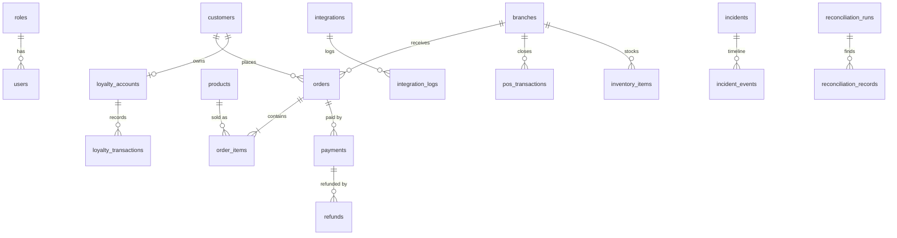

# 05 · Database & SQL Handbook

## 1. Relational concepts (as used here)
- **Table / row / column** — `orders` holds one row per order.
- **Primary key** — `id SERIAL` on every table (surrogate key); natural keys are enforced separately with UNIQUE
  (`branches.code`, `products.sku`, `orders.order_number`).
- **Foreign key** — `orders.branch_id → branches.id`. `ON DELETE` choices are deliberate: `RESTRICT` where history
  must survive (you cannot delete a branch with orders), `CASCADE` for owned children (`order_items`,
  `incident_events`), `SET NULL` for optional links (`orders.customer_id`).
- **Constraints as business rules** — `CHECK (total >= 0)`, `CHECK (status IN (...))`,
  `UNIQUE (channel, external_ref)` (duplicate-order protection), `CHECK (points_balance >= 0)`.
- **Normalisation** — 3NF for operational tables (branch name lives once in `branches`); the warehouse is
  deliberately denormalised (star schema) for fast analytics.

## 2. Schema overview (25 application tables + `schema_migrations`)

Full DDL: `database/migrations/V001__initial_schema.sql` (generated from the models) and
`V002__defaults_triggers_views.sql` (hand-written). Table purposes: Master Handbook §9.

## 3. Migrations
- Runner: `backend/app/migrate.py` (`python -m app.migrate`, `--status`). Files `V###__name.sql`, applied in order,
  each in its own transaction, recorded with a SHA-256 checksum in `schema_migrations`.
- Rules: never edit an applied migration (the runner refuses on checksum mismatch); add `V003__…` instead.
- Drift guard: `test_migrated_schema_matches_orm_models` builds the DB *only* from migrations and compares every
  table's columns with the ORM.
- Bug found while building: the runner originally used `exec_driver_sql`, and psycopg treated the `%` in a
  PL/pgSQL `RAISE` message as a placeholder. Fix: execute migration files through a raw DBAPI cursor with no parameters.

## 4. Indexing
| Index | Supports |
|---|---|
| `ix_orders_branch_created (branch_id, created_at)` | dashboard & branch reports (verified with EXPLAIN → Index Only Scan) |
| `ix_orders_created_at`, `ix_orders_status` | date filters, work queues |
| `ix_payments_status_created` | payment status reports |
| `ix_integration_logs_integration_created`, `ix_integration_logs_entity` | monitoring, retry lookup |
| `ix_webhook_events_status`, `uq_webhook_source_event` | event history, de-dupe |
| Partial: `ix_payments_failed WHERE status='failed'`, `ix_orders_needs_action WHERE status IN ('received','failed')`, `ix_loyalty_failed_sync`, `ix_incidents_open` | tiny indexes for "needs attention" queries |
Trade-off: every index speeds reads but slows writes and uses space — only queries that run constantly get one.

## 5. Transactions
- Each request = one session; services `flush()`, routers `commit()`. If anything raises before commit, nothing is saved.
- **Savepoints** (`db.begin_nested()`): order insert (so a duplicate race rolls back only the insert) and each webhook handler (so a failed handler doesn't discard the event record).
- Partner ingest commits the order *before* POS forwarding, so a POS failure can never lose the order.
- Migrations: one transaction per file — a failing migration leaves no half-applied schema.

## 6. Data validation layers
Pydantic (shape) → service rules (meaning) → database constraints (last line of defence). The DB caught a real
seed bug: a deliberate "short payment" on a R29.90 order produced −R15.00 and violated `ck_payment_amount_positive`.

## 7. Audit logging
`audit_logs` (actor, action, entity_type, entity_id, details JSONB, ip, correlation_id). V002 adds trigger
`trg_audit_no_update` → UPDATE/DELETE raise `audit_logs is append-only` (tested). Example: Q12 in the SQL library.

## 8. SQL from this project
### Joins + aggregation — today's sales per branch (database/sql Q1)
```sql
SELECT b.code, b.name, COUNT(*) AS orders, SUM(o.total) AS sales_incl_vat, ROUND(AVG(o.total), 2) AS avg_ticket
FROM orders o JOIN branches b ON b.id = o.branch_id
WHERE (o.created_at AT TIME ZONE 'Africa/Johannesburg')::date = (now() AT TIME ZONE 'Africa/Johannesburg')::date
  AND o.status NOT IN ('cancelled','failed')
GROUP BY b.code, b.name ORDER BY sales_incl_vat DESC;
```
### Conditional aggregation — payment success (FILTER)
```sql
SELECT b.code,
       COUNT(*) FILTER (WHERE p.status IN ('captured','refunded','partially_refunded')) AS ok,
       COUNT(*) FILTER (WHERE p.status = 'failed') AS failed
FROM payments p JOIN orders o ON o.id = p.order_id JOIN branches b ON b.id = o.branch_id
GROUP BY b.code;
```
### Anti-join — captured but not settled (Q5)
```sql
SELECT p.id, p.provider_reference, p.amount
FROM payments p LEFT JOIN settlement_records s ON s.provider_reference = p.provider_reference
WHERE p.status = 'captured' AND s.id IS NULL;
```
### HAVING — duplicate charges (Q4)
```sql
SELECT o.order_number, COUNT(p.id) AS captured, SUM(p.amount) AS charged
FROM orders o JOIN payments p ON p.order_id = o.id AND p.status = 'captured'
GROUP BY o.id, o.order_number HAVING COUNT(p.id) > 1;
```
### Window functions — running total & 7-day moving average (Q8), top-N per group (Q9)
```sql
SELECT d, revenue, SUM(revenue) OVER (ORDER BY d) AS running_total,
       AVG(revenue) OVER (ORDER BY d ROWS BETWEEN 6 PRECEDING AND CURRENT ROW) AS ma_7d
FROM daily;
-- ROW_NUMBER() OVER (PARTITION BY branch ORDER BY SUM(line_total) DESC) <= 3
```
### Percentiles — integration latency (Q7)
`percentile_cont(0.95) WITHIN GROUP (ORDER BY response_ms)`.

All 13 queries in `database/sql/reporting_queries.sql` were executed against the seeded PostgreSQL database (exit 0).

## 9. Reconciliation matching logic (SQL view of the algorithm)
For business day D (SAST) the engine loads: orders of D (not cancelled) with payments; `pos_transactions` of D;
`settlement_records` of D. Per order it evaluates rules in this order and can emit several issues:
1. no captured & no failed payment (and order was fulfilled) → `missing_payment`
2. only failed payments → `failed_payment`
3. >1 captured → `duplicate_payment`
4. net captured ≠ total (and not refunded) → `amount_mismatch`
5. has `pos_check_ref` but no POS row → `missing_pos_record`; POS total ≠ order total → `pos_amount_mismatch`
6. each captured payment: no settlement → `missing_settlement`; settled ≠ captured → `settlement_mismatch`
7. finally each settlement line not referenced by any payment → `unknown_settlement`
`difference = actual − expected`; `discrepancy_value = Σ|difference|`; > R500 → SEV3 incident.
Verified by `test_reconciliation_matching_logic_detects_every_issue_type` (one order per issue type, exact counts and differences).

## 10. Operational vs analytical data
| | PostgreSQL (OLTP) | Snowflake (OLAP) |
|---|---|---|
| Purpose | run the business: orders, payments, state | analyse the business: trends, rankings, cohorts |
| Model | normalised, constraints, small transactions | star schema, wide scans, aggregates |
| Freshness | real time | nightly (incremental) |
| Load | many small writes | few large reads |
Keeping them separate means a heavy "12 months by branch by product" query never slows down order intake.

## 11. Snowflake & ELT
- `snowflake/schemas/01_account_setup.sql`: warehouse (XSMALL, auto-suspend 60 s), DB, schemas RAW/STAGING/ANALYTICS,
  roles LOADER/REPORTER, key-pair service user, CSV file format, internal stage.
- `02_raw_tables.sql`: landing tables matching CSV columns + `_extracted_at`.
- `transformations/01_staging.sql`: de-duplicate with `QUALIFY ROW_NUMBER() OVER (PARTITION BY id ORDER BY updated_at DESC) = 1` (handles incremental re-extracts), typed flags (`is_revenue`, `is_success`), response code.
- `transformations/02_analytics_marts.sql`: `dim_branch`, `dim_product`, `dim_date`, `fct_orders`, `fct_payments`, marts for daily branch sales, payment success, integration health, loyalty activity.
- `queries/analytical_queries.sql`: 9 questions (monthly by province, 7-day rank, week-on-week growth with LAG, delivery share, decline reasons, worst payment days, peak vs off-peak ticket, top products per category, integration reliability).
- `etl/extract_load.py`: incremental extract by watermark → Snowflake (PUT/COPY, key-pair) or **local DuckDB demo**.
- Verified locally: full run extracted 10,628 orders / 22k items / 10.5k payments, built 720 daily branch rows, all 9 queries returned results; incremental run with no changes left marts unchanged. **Not run against a Snowflake account** (no credentials).

## 12. Interview-ready explanations
- *Why a surrogate id and a unique business key?* Ids keep joins small and stable; unique business keys stop duplicates.
- *How do you stop double inserts under concurrency?* A UNIQUE constraint; catch the violation in a savepoint and read the winner.
- *Why partial indexes?* Most orders are completed; the "needs action" index only contains the handful of failed/received orders, so it's tiny and fast.
- *How would you speed up a slow report?* `EXPLAIN ANALYZE`, check for seq scans on large tables, add a composite index matching WHERE + ORDER BY, or move it to the warehouse.
