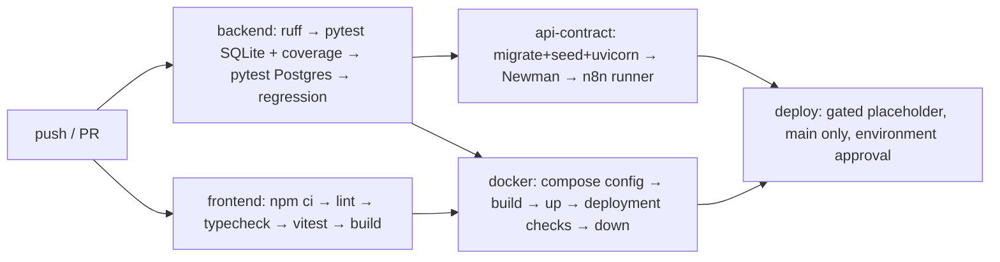

# 07 · DevOps & Deployment Handbook

> Status: Dockerfiles, Compose, nginx and the GitHub Actions workflow are written. `docker compose config` was
> validated. **Images were not built or run** in the build environment (no Docker daemon), and the workflow has not
> run on GitHub. Nothing is deployed to production.

## 1. Git
```bash
git init && git add . && git commit -m "feat: TableFlow Enterprise initial release"
git checkout -b feature/bolt-food-adapter      # one branch per change
git commit -m "feat(ordering): add Bolt Food adapter"   # conventional commits: feat/fix/docs/test/chore/refactor
git push -u origin feature/bolt-food-adapter   # open PR → CI runs → review → squash-merge to main
git tag v1.1.0 && git push --tags              # release tag
```
Branching: `main` (always releasable, protected: PR + green CI + 1 review) · `develop` (optional integration) ·
`feature/*`, `fix/*`, `hotfix/*`. Never commit `.env`, keys or `*.duckdb` (see `.gitignore`).

## 2. Docker
| Image | File | Notes |
|---|---|---|
| backend | `devops/docker/backend.Dockerfile` | multi-stage (deps → runtime), python:3.12-slim, non-root UID 10001, HEALTHCHECK on `/health/ready`, entrypoint migrates then optionally seeds |
| frontend | `devops/docker/frontend.Dockerfile` | node:22 build → nginx:1.27-alpine; `nginx.conf` serves SPA, proxies API, sets CSP and security headers |
```bash
docker build -f devops/docker/backend.Dockerfile -t tableflow-backend:dev .
docker build -f devops/docker/frontend.Dockerfile -t tableflow-frontend:dev .
docker run --rm -p 8000:8000 --env-file .env tableflow-backend:dev
```

## 3. Docker Compose
```bash
cp .env.example .env                 # set every CHANGE value
docker compose up --build -d         # postgres → backend (healthy) → frontend; n8n
docker compose ps                    # all "healthy"
docker compose logs -f backend       # JSON logs
docker compose --profile setup run --rm n8n-import   # import 8 workflows (inactive)
docker compose exec postgres psql -U tableflow -c "select count(*) from orders"
docker compose down                  # stop (keeps volumes)   |  down -v  → also deletes data
```
Services: `postgres:16-alpine` (volume `pgdata`, healthcheck `pg_isready`), `backend` (8000), `frontend` (8080),
`n8n` (5678, volume `n8ndata`, env for TableFlow URL/credentials/alert sink), `n8n-import` (profile `setup`).

## 4. Environment variables
Defined and typed in `backend/app/config.py`; template `.env.example`. Categories: database, security (JWT
secret, partner keys, webhook secrets, CORS), rate limits, seeding, n8n, integration retry/threshold, Snowflake.
Generate secrets with `openssl rand -hex 32`. In production use a secret manager (AWS Secrets Manager / Azure Key
Vault / Doppler) injected as env vars; rotate webhook secrets with providers in a planned window.

## 5. CI/CD pipeline (`.github/workflows/ci.yml`)

1. Install dependencies (pip/npm with caching). 2. Lint (ruff; ESLint + tsc). 3. Automated tests (pytest twice,
Vitest, Newman, n8n runner). 4. Build validation (`vite build`, Docker build). 5. Docker images. 6. Deployment
checks: wait for `/health/ready`, `/healthz`, SPA HTML, real login through nginx. Artifacts: JUnit, coverage, dist.

## 6. From development to testing to deployment
1. Develop on a feature branch locally (`uvicorn --reload`, `npm run dev`), write tests with the code.
2. Push → CI on the PR (all gates). Reviewer checks diff, tests, migrations, security.
3. Merge to `main` → CI again → images built.
4. *(Target design, not configured)*: push images to GHCR tagged with the git SHA → deploy to **staging**
   (run `python -m app.migrate` as a one-off job first) → smoke tests + UAT → manual approval on the GitHub
   `production` environment → deploy same image SHA to production → post-deploy checks → monitor error rate/p95 for 30 min.
5. Rollback: redeploy previous image SHA. Migrations must be backward compatible (expand → migrate → contract)
   so the previous version still runs on the new schema.

## 7. Health checks & monitoring
| Endpoint | Use |
|---|---|
| `GET /health` | liveness (process up) |
| `GET /health/ready` | readiness: DB `SELECT 1` latency + integration statuses; 503 if DB down |
| `GET /metrics` | request totals, status classes, error rate, p50/p95/p99, top endpoints, uptime |
| `GET /healthz` (nginx) | frontend container |
Logs: JSON to stdout with `correlation_id`; ship to Loki/CloudWatch/Datadog. Alerts: n8n workflows + suggested
platform alerts (5xx rate > 1% for 5 min, p95 > 1 s, `/health/ready` failing, integration `down`). Production
upgrade: Prometheus exporter or OpenTelemetry instead of in-process metrics.

## 8. Release management
Semantic versioning; release notes from conventional commits; release checklist in Doc 06 §12; changes to
payments/reconciliation require Finance sign-off; deploy outside peak trading (avoid 11:30–14:00 and 17:00–20:00 SAST).

## 9. Common problems
| Problem | Fix |
|---|---|
| `POSTGRES_PASSWORD` required error | create `.env` from `.env.example` |
| backend unhealthy | `docker compose logs backend` – usually DB URL/password or failed migration |
| `Checksum mismatch for already-applied migration` | someone edited an applied migration — revert it, add a new V file |
| Port 5432/8000/8080 in use | stop local services or change host ports in compose |
| n8n can't reach backend | use `http://backend:8000` inside the network, not localhost |
