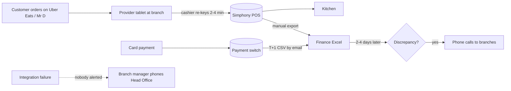
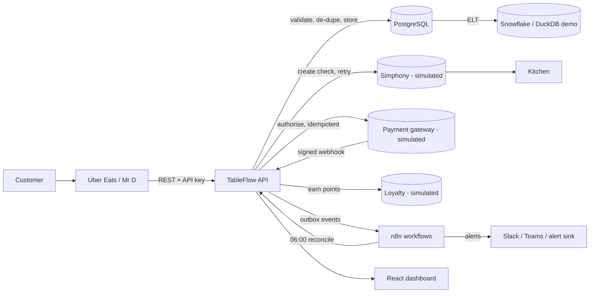
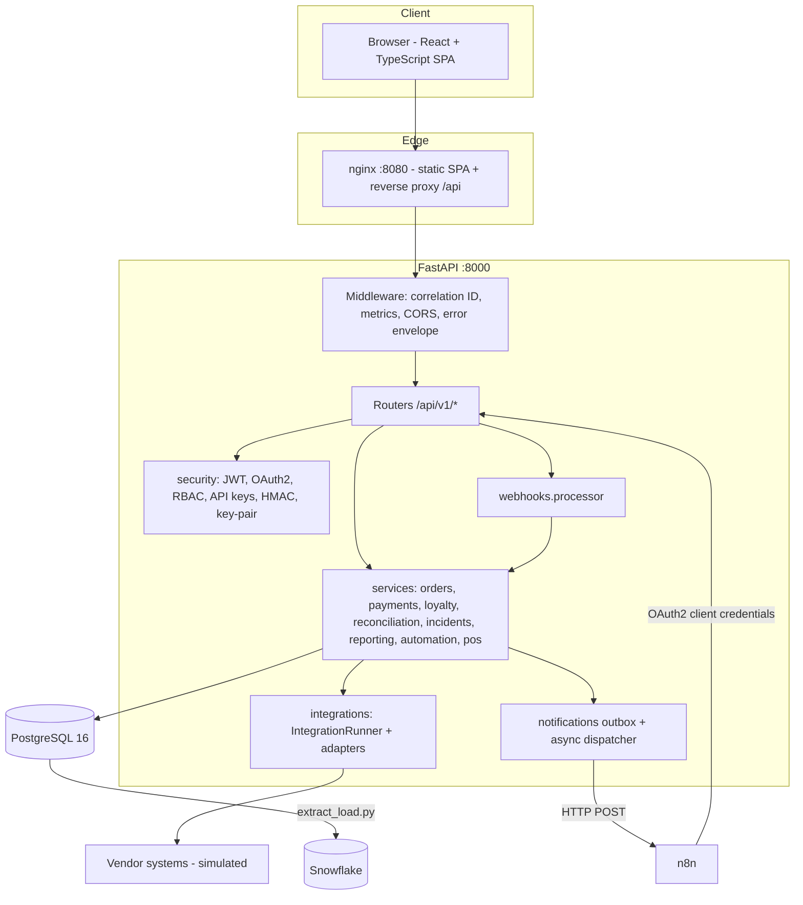
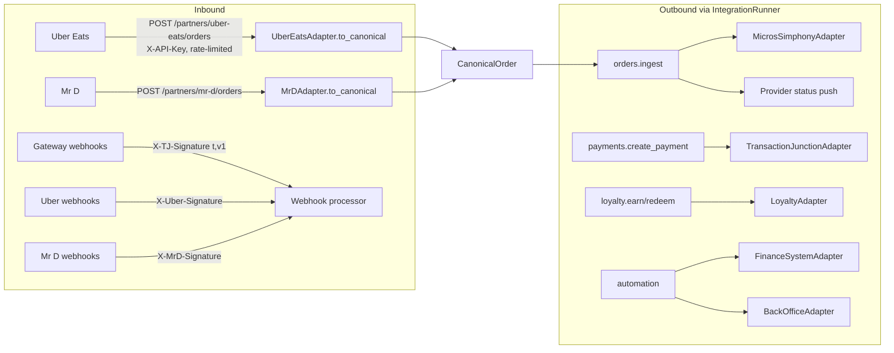
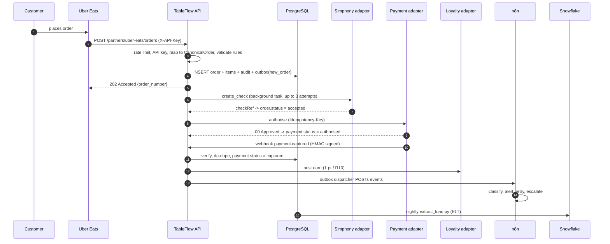
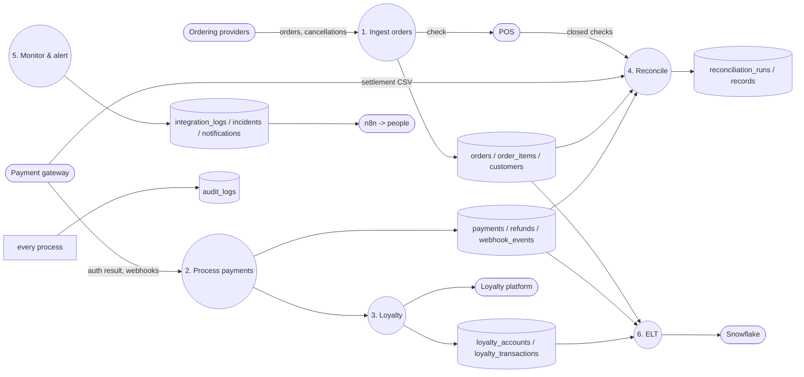
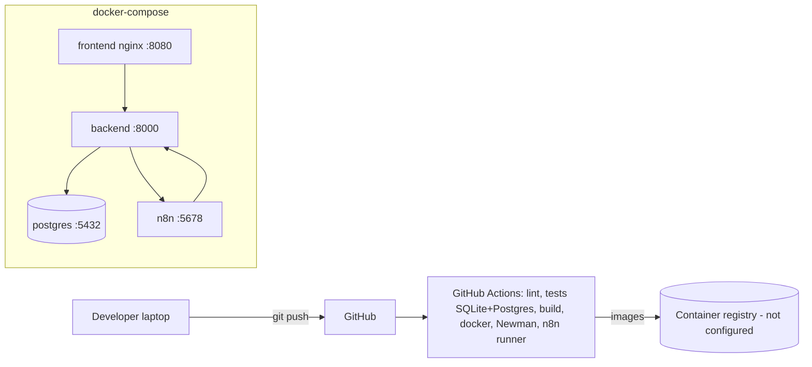

# 04 · Process Maps, System Architecture, Integration Architecture & Data Flows

All diagrams are Mermaid (render on GitHub, in VS Code with a Mermaid extension, or at mermaid.live).

## 1. Current-state process (before TableFlow)

## 2. Future-state process (with TableFlow)

## 3. System architecture

| Component | Responsibility | Tech |
|---|---|---|
| React SPA | 17 screens (incl. login), charts, forms, validation, error/loading states | React 18, TypeScript, Vite, Recharts |
| nginx | Serves SPA, proxies API (single origin), security headers | nginx 1.27 |
| FastAPI | REST API, validation, auth, business logic | Python 3.12+, FastAPI, Pydantic v2 |
| IntegrationRunner | Retries, logging, health, auto-incidents for every vendor call | `integrations/base.py` |
| Adapters | Map TableFlow ↔ vendor formats (simulated transport) | `integrations/*.py` |
| Webhook processor | Verify, de-dupe, process, replay | `webhooks/processor.py` |
| Outbox | Reliable, non-blocking notifications to n8n | `services/notifications.py` |
| PostgreSQL | System of record, constraints, triggers, views | PostgreSQL 16, SQL migrations |
| n8n | 8 workflows: alerts, retries, scheduled reconciliation & reports | n8n 1.x |
| Snowflake | Analytical warehouse (RAW → STAGING → ANALYTICS) | SQL + Python ELT |

## 4. Integration architecture

Pattern summary: **canonical data model** (one internal order shape), **adapter** per vendor, **single choke
point** for outbound calls (retry/log/health), **idempotency** at every inbound edge (orders, payments, webhooks),
**transactional outbox** for notifications.

## 5. End-to-end data flow — digital order (the 10 steps)

Step-by-step:
1. **Customer places a digital order** in the Uber Eats app.
2. **Provider sends an API request** to `/api/v1/partners/uber-eats/orders` with its API key; the sliding-window rate limiter and `require_partner_key` run first.
3. **Backend validates**: Pydantic parses the body; `UberEatsAdapter.to_canonical` maps cents→Rand and provider fields → `CanonicalOrder`; `orders.ingest` applies BR-ORD-01..05.
4. **Order stored in PostgreSQL** inside one transaction with its items, the customer upsert, an `audit_logs` row and a `notifications` outbox row. Response **202** is returned immediately.
5. **Forwarded to the POS adapter** in a FastAPI background task: `forward_to_pos` → `IntegrationRunner.call` → `MicrosSimphonyAdapter.create_check`. Success sets `pos_check_ref` and `accepted`; failure after retries sets `failed` and queues a `pos_failure` alert.
6. **Payment processed** through `POST /payments` with an `Idempotency-Key`; `TransactionJunctionAdapter.authorise` returns an ISO 8583-style response code.
7. **Webhook confirms payment**: the gateway (simulated) posts `payment.captured` signed with HMAC-SHA256 + timestamp; the processor verifies, de-duplicates, and sets `captured`.
8. **Loyalty points updated** inside the same handler: `loyalty.earn_for_order` writes the local ledger first, then posts to the platform; failure is kept as `failed` for retry.
9. **n8n triggers notifications**: the outbox dispatcher (async loop) POSTs pending rows to n8n webhook paths; workflows decide who to alert and may call back into the API.
10. **Analytics**: `snowflake/etl/extract_load.py` extracts incrementally (watermark on `updated_at`) and loads Snowflake RAW, then SQL builds STAGING and ANALYTICS marts.

## 6. Data flow diagram (level 1)

## 7. Deployment view

